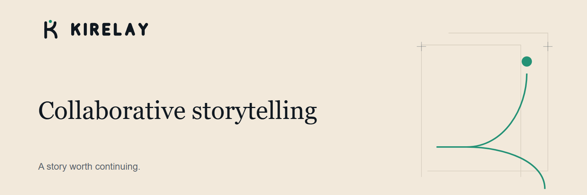

  <a href="https://kirelay.com"><strong>Explore Kirelay ↗</strong></a>
  &nbsp; · &nbsp;
  <a href="https://github.com/Kirelay/.github/blob/main/CONTRIBUTING.md">Contribute</a>

## Every story opens another possibility.

Kirelay is a collaborative storytelling platform for continuing stories and exploring new branches. Start with a shared beginning, take it in a new direction, and discover where another writer carries it next.

**Write together.** Build on a story someone else has begun.

**Explore another path.** Let different continuations grow from the same moment.

**Keep creating.** Give each idea room to become its own story.

---

### Across the Kirelay projects

| Project | Focus |
| --- | --- |
| **Kirelay** | Collaborative stories, shared beginnings, and branching paths. |
| **Kirelay for Android** | Bringing the storytelling experience to mobile. |
| **Kirelay Studio** | Local-first writing, creative history, and room to explore alternatives. |

These projects are under development. Availability and supported features vary by project.

### Build with us

Improvements to documentation, accessibility, and the writing experience are welcome. Start with a project's README, describe the problem you want to solve, and share what you verified.

[Read the contribution guide →](https://github.com/Kirelay/.github/blob/main/CONTRIBUTING.md)

---

Kirelay · Collaborative storytelling

