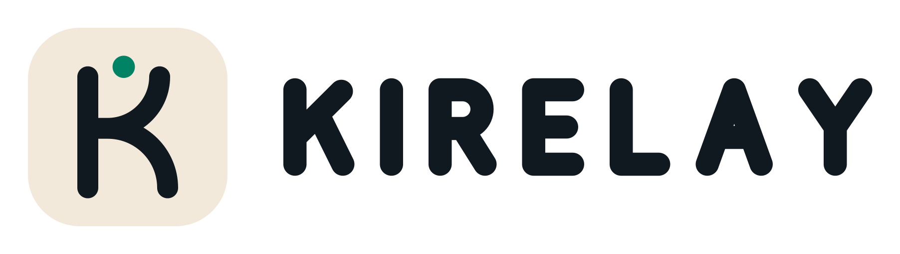

<picture>
  <source media="(prefers-color-scheme: dark)" srcset="../assets/kirelay-lockup-horizontal-dark.svg">
  
</picture>

## Stories grow through collaboration

Kirelay is a collaborative storytelling platform for continuing stories and exploring new branches. Writers can build on a shared beginning, take a story in another direction, and discover where others carry it next.

Our work spans the storytelling platform, an Android client, and Kirelay Studio, a local-first writing tool for exploring branches and preserving creative history. These projects are under development; availability and supported features vary by project.

[Explore Kirelay](https://kirelay.com)

## Contributing

For projects available here, start with the repository's README and contribution guidelines. Use its issue tracker for reproducible bugs and focused feature suggestions, and describe what you tested when submitting a pull request.

Small improvements to documentation, accessibility, and the writing experience are welcome.
